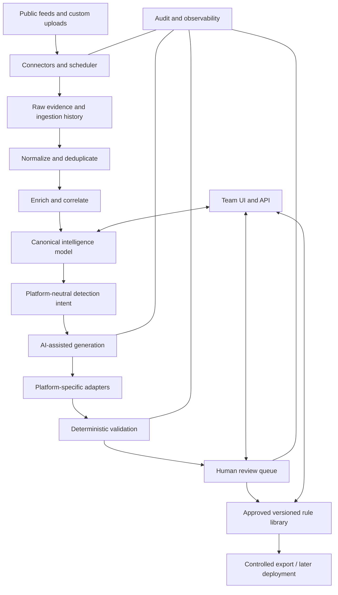

# System Architecture

## Product goals

Build a team-oriented platform that turns traceable threat intelligence into reviewable, platform-specific detection content. The initial product covers ingestion, enrichment, generation, validation, review, versioning, and export. Production deployment integrations are a later gated capability.

## Logical workflow

## Proposed components

| Component | Responsibility |
|---|---|
| React + TypeScript UI | Dashboard, intelligence center, generator, validation, review queue, rule library, team administration |
| FastAPI | Authentication, authorization, APIs, workflow orchestration |
| PostgreSQL | Organizations, users, intelligence, evidence, rules, versions, reviews, audit events |
| Celery + Redis | Daily feed jobs, enrichment, generation and validation tasks |
| Feed connectors | Fetch, parse, checkpoint, rate-limit and report source health |
| Normalization | Canonical IOC values/types, timestamps, deduplication and provenance |
| Enrichment/correlation | Threat entities, campaigns, malware, vulnerabilities and ATT&CK mapping |
| AI service | Structured detection intent and candidate rule generation |
| Platform adapters | Convert detection intent to each target query/rule format |
| Validators | Schema, syntax where supported, field mappings, freshness, duplicates and fixture tests |
| Review workflow | Assignment, comments, approval/rejection, immutable versions |
| Audit/observability | Actor/action history, job outcomes, metrics and traces |

## Intelligence sources

Initial candidate connectors:
- CISA Known Exploited Vulnerabilities (KEV) and CISA advisories.
- AlienVault OTX.
- abuse.ch projects including URLhaus and ThreatFox.
- NVD CVE data.
- MITRE ATT&CK.
- Organization-configured STIX 2.x / TAXII sources.
- Custom CSV, JSON and STIX bundle uploads.

Connector availability, API access, terms, redistribution rights and rate limits must be verified before implementation. A connector registry should describe each source's auth requirements, supported object types, polling strategy, licensing notes, parser version and health.

### Ingestion controls

1. Daily scheduled ingestion with per-source checkpoints.
2. Idempotent fetch/parse/store operations.
3. Preserve source references, source timestamps, ingestion time and payload hashes.
4. Normalize and deduplicate while retaining multiple source-evidence links.
5. Track confidence, source reliability, first/last seen and expiry where available.
6. Quarantine malformed or suspicious records.
7. Retry transient failures with bounded backoff; expose source health and run statistics.
8. Treat all external feed content as untrusted data, never as instructions to the AI system.

## Canonical data model

Initial entities:
- **Organization** — tenant boundary and configuration.
- **User / TeamMembership** — identity, organization, role and status.
- **IntelSource** — connector settings, source metadata, enabled state and health.
- **IngestionRun** — timestamps, status, checkpoint, counts and errors.
- **IntelRecord** — canonical indicator/intelligence object, type/value, confidence, severity, first/last seen, expiry and lifecycle.
- **IntelEvidence** — source relationship, URL/reference, source timestamp and payload hash.
- **ThreatEntity** — actor, malware, campaign, tool, vulnerability or infrastructure.
- **IntelRelationship** — typed relationships between records and entities.
- **AttackTechnique** — ATT&CK technique ID and mapping rationale.
- **DetectionIntent** — platform-neutral detection hypothesis, required telemetry, fields, evidence and test cases.
- **DetectionRule** — logical rule identity, platform, metadata, status and current version.
- **RuleVersion** — immutable query snapshot, generator/adapter metadata and validation state.
- **ValidationResult** — validator, findings, evidence and timestamp.
- **Review** — reviewer, decision, comments and timestamps.
- **AuditEvent** — actor, action, target, timestamp and correlation ID.

Use organization-scoped foreign keys and enforce tenant isolation in every API query. Store secrets in a secret manager or secure deployment environment, never in source control or ordinary application records.

## Hybrid generation design

### Platform-neutral detection intent

Before generating a platform query, create a structured intent containing:
- Detection objective and threat hypothesis.
- Behavior, event sequence or indicator pattern.
- Related intelligence record IDs and source evidence.
- ATT&CK tactic/technique mappings and rationale.
- Required telemetry sources, event categories and fields.
- Time window, grouping keys, thresholds and exclusions.
- Expected alert context and severity rationale.
- False-positive considerations, limitations and test scenarios.

### Generation sequence

1. Select a correlated intel cluster or analyst-selected records.
2. Build a prompt from trusted structured fields with source text clearly delimited as untrusted evidence.
3. Request schema-constrained detection intent or rule output.
4. Reject malformed or unsupported model responses.
5. Render through a platform-specific adapter.
6. Run deterministic validators and supported offline fixtures.
7. Store a candidate version with model/provider, prompt-template and adapter versions.
8. Submit the candidate to human review.

The model must not invent telemetry fields, data sources or platform functions. Unknown field mappings must be explicit assumptions requiring analyst confirmation.

## Platform adapters

| Platform | Output | Validation strategy |
|---|---|---|
| Splunk | SPL search / correlation-search definition | SPL linting where available, fixture tests, field mapping checks |
| Google SecOps / Chronicle | YARA-L 2.0 rule | Schema/syntax validation using supported tooling or API; fixtures |
| Microsoft Sentinel | KQL analytics query and metadata | KQL parser/tooling where available; schema and fixture checks |
| CrowdStrike Next-Gen SIEM | Current supported query/rule representation | Verify exact current product/API contract; adapter contract tests |

These languages are not interchangeable. Keep independent adapters, capability matrices, test fixtures and versioned platform documentation. Confirm the exact CrowdStrike query dialect and supported validation/deployment APIs before implementation.

## Deterministic validation

- Required schema and metadata.
- Source evidence and provenance references.
- Platform and adapter version compatibility.
- Data-source and field mapping checks against organization configuration.
- IOC freshness and expiry warnings.
- Duplicate/near-duplicate checks.
- Syntax/compile checks where supported.
- Positive and negative fixture-based tests.
- Severity and ATT&CK mapping completeness.

A syntax pass is not proof of detection efficacy. Show validation coverage, assumptions and unresolved findings to reviewers.

## Rule lifecycle

`Draft → Generated → Validation failed / Ready for review → In review → Approved → Exported or deployed`

Additional states: `Rejected`, `Deprecated`, `Superseded`.

- Daily ingestion may create new candidates and proposed updates.
- Approved versions are immutable; changes create a new candidate version.
- Material changes require fresh validation and review.
- Approval binds to an exact version hash and validation evidence.
- Only approved versions can be exported.
- Stale intel flags impacted rules for review; it never silently deletes or changes an approved rule.

## Team roles

- **Admin:** manage team, roles, connectors, platform configuration and secrets references.
- **Detection Engineer:** upload/ingest intelligence, generate/edit drafts, validate and submit for review.
- **Reviewer / Approver:** review, comment, request changes, approve or reject.
- **Viewer:** read dashboards, intelligence and rules; export access is separately configurable.

Design for organization-level tenancy from the beginning. Enforce permissions in the API, not only the UI. OIDC/SSO is a planned identity integration.

## Proposed API surface

- `GET /api/v1/dashboard/summary`
- `GET /api/v1/intel`, `GET /api/v1/intel/{id}`
- `POST /api/v1/intel/uploads`
- `GET /api/v1/sources`, `POST /api/v1/sources`, `POST /api/v1/sources/{id}/run`
- `GET /api/v1/ingestion-runs`
- `POST /api/v1/detection-intents`
- `POST /api/v1/rules/generate`
- `GET /api/v1/rules`, `GET /api/v1/rules/{id}`
- `POST /api/v1/rules/{id}/validate`
- `POST /api/v1/rules/{id}/submit-review`
- `POST /api/v1/rules/{id}/reviews`
- `GET /api/v1/review-queue`
- `GET /api/v1/rules/{id}/versions`
- `POST /api/v1/rules/{id}/export`
- `GET /api/v1/audit-events`

All business endpoints require authentication, organization scoping, authorization, input validation, pagination and rate limits.

## Operations

Start with Docker Compose services for web, API, worker, scheduler, PostgreSQL and Redis. Production can later use managed database/cache and container orchestration.

Include health/readiness checks, structured logs with correlation IDs, metrics for feed success/lag, queue depth, generation failures, validation outcomes and review aging, encrypted backups, restore tests, bounded retries and dead-letter handling.

## Decisions to confirm during implementation

1. Identity provider and SSO/OIDC requirements.
2. LLM provider, data residency, retention and whether submitted intelligence may be sent to it.
3. Exact CrowdStrike NG-SIEM query/API contract.
4. Feed licensing, redistribution and rate limits.
5. Export-only initial release versus later approved deployment.
6. Team tenancy and retention requirements.
